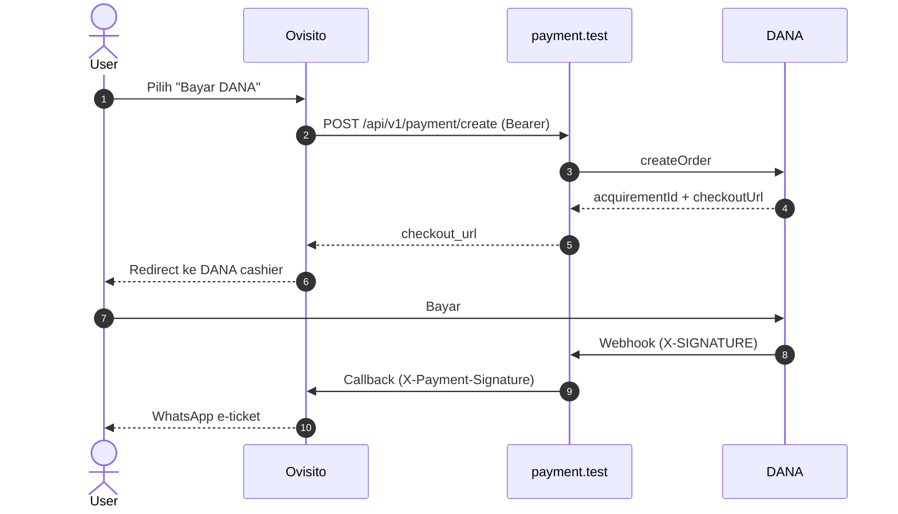

<div align="center">

# 💳 Ovisito Payment Service

**Gateway pembayaran terpusat untuk ekosistem Ovisito — DANA hari ini, Flip, GoPay, dan BSI besok.**


</div>

---

## Tentang

`payment.test` (production: `payment.ovisito.com`) adalah layanan pembayaran terpusat yang menangani transaksi atas nama `ovisito.com`. Layanan ini **tidak mengenal booking, observer, atau WhatsApp**. Tugasnya hanya:

1. Menerima permintaan pembayaran dari Ovisito
2. Membuat transaksi di gateway (DANA)
3. Memverifikasi webhook gateway
4. Mengirim callback ber-signature ke Ovisito

Seluruh *business logic* dan notifikasi tetap berada di Ovisito.

## Fitur

| | |
|---|---|
| 🔐 **Autentikasi berlapis** | Sanctum Bearer (ClientApp), signature RSA (DANA), HMAC webhook (callback ke Ovisito) |
| ♻️ **Idempotent** | Permintaan create, webhook, dan callback aman diulang tanpa efek ganda |
| 🩹 **Self-healing** | Retry callback, polling status, dan auto-expire berjalan via scheduler |
| 🔌 **Extensible** | Gateway baru cukup menambah satu class yang mengimplementasikan interface |
| 👥 **Multi-client** | Tabel `client_apps` dengan rate limit dan scope token per client |
| 🛡️ **Aman secara default** | Verifikasi signature webhook wajib (`PAYMENT_REQUIRE_SIGNATURE=true`) |

## Arsitektur



| Arah | Mekanisme |
|---|---|
| Ovisito → payment.test | `Authorization: Bearer {token}` (Sanctum ClientApp) |
| DANA → payment.test | `X-SIGNATURE` (RSA-SHA256) |
| payment.test → Ovisito | `X-Payment-Signature` (HMAC-SHA256 atas `timestamp.body`) |

## Prasyarat

- PHP 8.2+, Composer, MySQL 8+
- Laravel 10 atau 11
- Package [`otnansirk/laravel-dana`](https://packagist.org/packages/otnansirk/laravel-dana)
- Akun [DANA Sandbox](https://dashboard.dana.id/sandbox) (Merchant ID, Client ID/Secret, RSA key pair, DANA public key)
- URL HTTPS publik untuk webhook (lokal: `ngrok` atau `cloudflared`)

## Instalasi Cepat

```bash
# 1. Dependensi
composer install
composer require laravel/sanctum
php artisan install:api

# 2. Environment
cp .env.example .env
php artisan key:generate

# 3. Database
mysql -u root -e "CREATE DATABASE payment_gateway CHARACTER SET utf8mb4 COLLATE utf8mb4_unicode_ci;"
php artisan migrate
php artisan db:seed --class=ClientAppSeeder

# 4. Jalankan
php artisan serve
```

Generate secret antar-service (jalankan dua kali, satu per secret):

```bash
php -r "echo bin2hex(random_bytes(32)) . PHP_EOL;"
```

## Konfigurasi

Variabel utama di `.env` (daftar lengkap ada di dokumentasi):

| Variabel | Fungsi |
|---|---|
| `DANA_MARCHANT_ID`, `DANA_CLIENT_ID`, `DANA_CLIENT_SECRET` | Kredensial merchant DANA (`MARCHANT` adalah ejaan package) |
| `DANA_PRIVATE_KEY`, `DANA_PUB_KEY` | RSA key (tanda kutip ganda, baris baru ditulis `\n`) |
| `DANA_ORDER_NOTIFY_URL` | URL webhook DANA (HTTPS publik) |
| `DANA_PAY_RETURN_URL` | URL kembali setelah user membayar |
| `PAYMENT_REQUIRE_SIGNATURE` | `true` di production; `false` hanya untuk uji lokal |
| `OVISITO_CLIENT_ID`, `OVISITO_CLIENT_SECRET` | Kredensial ClientApp untuk Ovisito |
| `OVISITO_CALLBACK_URL`, `OVISITO_CALLBACK_PATH` | Tujuan callback hasil pembayaran |
| `OVISITO_WEBHOOK_SECRET` | Secret HMAC callback (harus sama dengan di Ovisito) |

> [!WARNING]
> Jangan commit `.env`, secret, atau private key. Jika pernah terekspos, rotasi segera.

## Endpoint

| Method | Path | Auth | Deskripsi |
|---|---|---|---|
| `POST` | `/api/v1/auth/login` | publik (throttle) | Tukar `client_id` + `client_secret` dengan Bearer token |
| `GET` | `/api/v1/auth/me` | Bearer | Info client |
| `POST` | `/api/v1/auth/refresh` | Bearer | Perbarui token |
| `POST` | `/api/v1/auth/logout` | Bearer | Cabut token |
| `POST` | `/api/v1/payment/create` | Bearer | Buat transaksi, mengembalikan `checkout_url` |
| `GET` | `/api/v1/payment/status/{referenceId}` | Bearer | Cek status transaksi |
| `POST` | `/api/webhook/dana` | signature DANA | Menerima Finish Notify dari DANA |
| `GET` | `/payment/return` | publik | Halaman status setelah user kembali dari DANA |

### Contoh Penggunaan

```bash
# Login
TOKEN=$(curl -s -X POST https://payment.ovisito.com/api/v1/auth/login \
  -H "Content-Type: application/json" \
  -d '{"client_id":"ovisito-core","client_secret":"<secret>"}' | jq -r '.data.access_token')

# Buat pembayaran
curl -X POST https://payment.ovisito.com/api/v1/payment/create \
  -H "Authorization: Bearer $TOKEN" \
  -H "Content-Type: application/json" \
  -d '{
    "reference_id": "TRX-001",
    "amount": 150000,
    "provider": "dana",
    "return_url": "https://ovisito.com/payment/return",
    "customer": {"name": "Budi", "phone": "081234567890"}
  }'
```

```json
{
  "success": true,
  "data": {
    "transaction_id": "9f2c...",
    "external_id": "2026110512...",
    "checkout_url": "https://m.sandbox.dana.id/...",
    "provider": "dana",
    "expires_at": "2026-11-05T11:00:00+07:00",
    "reused": false
  }
}
```

### Format Callback ke Ovisito

```json
{
  "id": "evt_<transaction-uuid>_paid",
  "type": "payment.paid",
  "created_at": "2026-11-05T10:15:00+07:00",
  "data": {
    "reference_id": "TRX-001",
    "external_id": "2026110512...",
    "provider": "dana",
    "amount": 150000,
    "status": "paid",
    "paid_at": "2026-11-05T10:14:52+07:00"
  }
}
```

Header: `X-Payment-Signature`, `X-Payment-Timestamp`, `X-Payment-Event`, `X-Payment-Delivery-Id`.
Signature: `sha256=` + `HMAC-SHA256(timestamp + "." + body, secret)`. Event: `payment.paid`, `payment.expired`, `payment.failed`.

## Scheduler

Daftarkan satu entri cron di server:

```bash
* * * * * cd /var/www/payment && php artisan schedule:run >> /dev/null 2>&1
```

| Command | Frekuensi | Fungsi |
|---|---|---|
| `payment:retry-callbacks` | tiap menit | Kirim ulang callback gagal (backoff eksponensial, maks. 10×) |
| `payment:poll-pending` | tiap 2 menit | Query DANA bila webhook tidak masuk |
| `payment:expire-pending` | tiap 5 menit | Tandai transaksi lewat `expires_at` sebagai `EXPIRED` |

## Struktur Proyek

```text
app/
├── Console/Commands/        # retry, poll, expire
├── Contracts/               # PaymentGatewayInterface
├── Http/Controllers/
│   ├── Api/V1/              # AuthController, PaymentController
│   ├── Api/WebhookController.php
│   └── PaymentReturnController.php
├── Models/                  # ClientApp, PaymentTransaction
└── Services/
    ├── Gateways/            # DanaGateway (+ gateway lain)
    ├── OvisitoCallbackService.php
    └── PaymentManager.php
```

## Menambah Gateway Baru

1. Buat `app/Services/Gateways/FlipGateway.php` yang mengimplementasikan `PaymentGatewayInterface`
2. Daftarkan di `PaymentManager::driver()`
3. Tambahkan route `POST /api/webhook/flip`
4. Delegasikan ke `WebhookController::handleGenericWebhook($request, 'flip')`

Tidak ada perubahan pada auth, `PaymentController`, callback, maupun skema database.

## Pengujian

```bash
php artisan route:list | grep -E "auth|payment|webhook"   # verifikasi rute
php artisan payment:expire-pending                         # uji expire manual
php artisan payment:retry-callbacks                        # uji retry manual
tail -f storage/logs/laravel.log | grep -iE "webhook|callback|dana"
```

Skenario uji lengkap (login, create, bayar sandbox, idempotency, retry, expire, signature palsu) ada di dokumentasi bagian *Pengujian End-to-End*.

> [!TIP]
> Untuk uji `curl` manual di lokal, set sementara `PAYMENT_REQUIRE_SIGNATURE=false`. Kembalikan ke `true` sebelum deploy.

## Checklist Production

- [ ] `APP_ENV=production`, `APP_DEBUG=false`
- [ ] Kredensial DANA production terpasang
- [ ] `PAYMENT_REQUIRE_SIGNATURE=true` dan `DANA_PUB_KEY` terisi
- [ ] `DANA_ORDER_NOTIFY_URL` dan `DANA_PAY_RETURN_URL` memakai HTTPS publik
- [ ] `OVISITO_CLIENT_SECRET` dan `OVISITO_WEBHOOK_SECRET` identik di kedua project
- [ ] `php artisan migrate --force` dan `ClientAppSeeder` sudah dijalankan
- [ ] Cron `schedule:run` aktif
- [ ] `storage/logs` tidak world-readable
- [ ] Satuan nominal DANA, format signature webhook, dan nama method package sudah diverifikasi di sandbox

## Dokumentasi

| Dokumen | Isi |
|---|---|
| [`payment-service-dokumentasi-v2.md`](payment-service-dokumentasi-v2.md) | Panduan implementasi lengkap: kode, konfigurasi, pengujian, deployment, troubleshooting |

## Troubleshooting Singkat

| Gejala | Tindakan |
|---|---|
| Login 401 | Jalankan `ClientAppSeeder`, samakan secret dengan `.env` |
| Create 502 | Periksa kredensial dan format `\n` pada RSA key DANA |
| Webhook tidak masuk | Pastikan URL notify HTTPS publik dan tunnel aktif |
| Webhook 401 | Isi `DANA_PUB_KEY`; cek header `X-SIGNATURE` |
| Callback ke Ovisito 401 | Samakan webhook secret dan sinkronkan jam server (toleransi 5 menit) |

## Lisensi & Kepemilikan

Perangkat lunak internal milik **PT Balai Digital Teknologi**. Seluruh hak dilindungi.

<div align="center">

*Dikembangkan oleh Tim Engineering Ovisito · Banda Aceh, Aceh*

</div>
